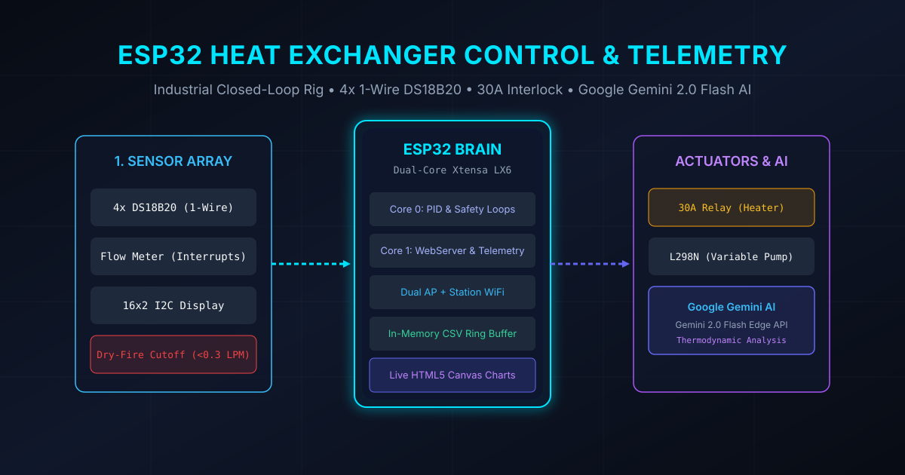

## ♨️ Industrial Embedded Rig Overview

An industrial-grade embedded control, telemetry, and thermodynamic analysis system designed for a liquid-to-liquid heat exchanger testing rig powered by an **ESP32 DevKitC**.

---

## 📐 System Architecture & Hardware Layer

The controller manages a multi-loop electro-thermal system with strict hardware-enforced fail-safes:

1. **Sensory Layer**:
   - **4x DS18B20 Digital Temperature Sensors** on a shared 1-Wire bus (GPIO 4) measuring Hot Inlet, Hot Outlet, Cold Inlet, and Cold Outlet temperatures.
   - **Hall-Effect Pulse Flow Meter** connected via level-shifted hardware interrupt pins for sub-second flow rate calculation.
   - **16x2 I2C Character Display** providing immediate local status readouts of temperatures, flow rates, and heater states.

2. **Actuator & Power Electronics**:
   - **30A High-Power Relay Module** controlling the primary immersion heating element.
   - **L298N Dual Full H-Bridge Driver** delivering variable PWM speed control to the DC water pump for dynamic flow throttling.

3. **Hard Safety Interlocks**:
   - **Zero-Flow Dry-Fire Prevention:** The heater relay is mechanically isolated and immediately de-energized if flow falls below 0.3 LPM to prevent catastrophic heating element burnout.
   - **Over-Temperature Cutoff:** Automatic trip if any fluid line exceeds 75°C.
   - **Sensor Disconnect Lockout:** Failsafe shutdown if any of the 4 probes fails CRC checks.

---

## 🌐 Dual AP+Station Web Dashboard

The ESP32 hosts a self-contained, responsive telemetry dashboard:
- **SoftAP (192.168.4.1) & Station Mode:** Technicians can connect directly to the rig in the field or connect it to plant Wi-Fi.
- **In-Memory CSV Logging:** High-resolution thermodynamic data is buffered into flash ring memory with instantaneous CSV export for MATLAB / Python processing.
- **Real-Time HTML5 Canvas Charts:** Live multi-channel temperature curves and flow graphs rendered in-browser without external internet access or third-party cloud brokers.

---

## 🤖 Google Gemini 2.0 Flash AI Edge Integration

The controller embeds an autonomous HTTPS REST client connecting directly to **Google Gemini 2.0 Flash**:
- Periodically snapshots thermodynamic states: inlet/outlet differentials ($\Delta T_{hot}, \Delta T_{cold}$), mass flow rates ($\dot{m}$), and Log Mean Temperature Difference (LMTD).
- Receives structured diagnostic insights, fouling predictions, and operational efficiency tuning recommendations directly displayed on the web interface.

- **GitHub Repository:** [github.com/EnejiOhieku/heat-exchanger-controller](https://github.com/EnejiOhieku/heat-exchanger-controller)
