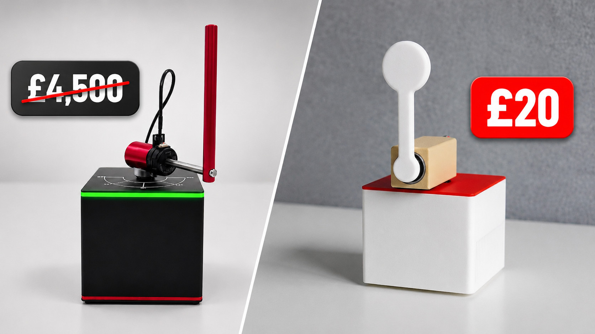

## 🎯 Project Overview

The **Furuta Rotary Inverted Pendulum** is a classic benchmark in underactuated control theory and non-linear dynamics. A horizontal actuated rotary arm drives an unactuated vertical pendulum arm, creating a complex non-minimum phase, unstable dynamic system.

---

## 🔬 Mathematical Modeling & Hybrid Control

The system state is defined by the rotary arm angle $\theta$ and the pendulum angle $\alpha$:

$$\mathbf{x} = \begin{bmatrix} \theta & \alpha & \dot{\theta} & \dot{\alpha} \end{bmatrix}^T$$

Stabilization requires a seamless handoff between two distinct control regimes:

1. **Non-Linear Energy-Shaping Swing-Up**:
   When hanging at rest ($\alpha = \pi$), linear control cannot reach the upright equilibrium. The energy controller computes the total mechanical energy of the pendulum $E(\alpha, \dot{\alpha})$ and drives the rotary arm back and forth to pump energy into the system until $E \approx E_0$ (the potential energy at the upright apex).

2. **Linear Quadratic Regulator (LQR) Balance**:
   Once the pendulum enters the basin of attraction ($|\alpha| < 15^\circ$), control switches instantaneously to an optimal infinite-horizon discrete LQR:
   $$u = -\mathbf{K}\mathbf{x} = -\begin{bmatrix} k_1 & k_2 & k_3 & k_4 \end{bmatrix} \begin{bmatrix} \theta \\ \alpha \\ \dot{\theta} \\ \dot{\alpha} \end{bmatrix}$$
   The gain matrix $\mathbf{K}$ is synthesized by solving the Algebraic Riccati Equation (ARE) with tuned $\mathbf{Q}$ and $R$ penalty matrices.

---

## ⚡ Embedded Firmware & Sensor Pipeline (Zephyr RTOS)

- **Dedicated 400 Hz Sampling Thread:** An autonomous high-priority Zephyr RTOS thread polls the contactless **AS5600 12-bit magnetic rotary encoder** over I2C at 400 kHz, eliminating phase lag and encoder jitter.
- **Velocity Estimation:** Angular velocities $\dot{\theta}$ and $\dot{\alpha}$ are filtered via an exponential moving average (EMA) low-pass filter to reject sensor quantization noise without introducing destabilizing phase delay.
- **Actuation:** A high-torque NEMA 17 stepper motor driven by a **TMC2209** silent stepper driver configured with 1/16 microstepping and stealthChop for smooth, vibration-free torque delivery.
- **Interactive 3D Visualizer:** Real-time state telemetry rendered in 60 FPS using an embedded **Raylib** physical simulation pipeline.

- **GitHub Repository:** [github.com/EnejiOhieku/rotary-inverted-pendulum](https://github.com/EnejiOhieku/rotary-inverted-pendulum)
