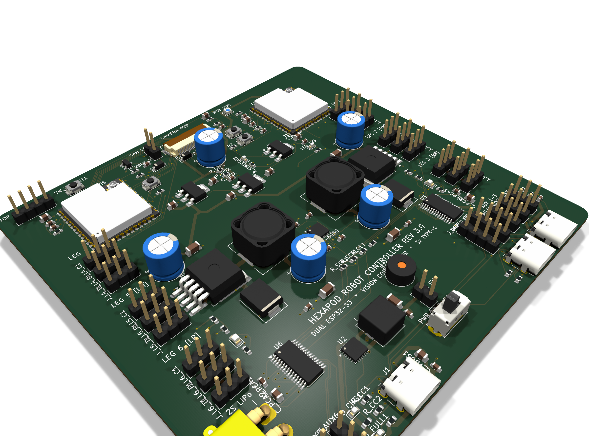
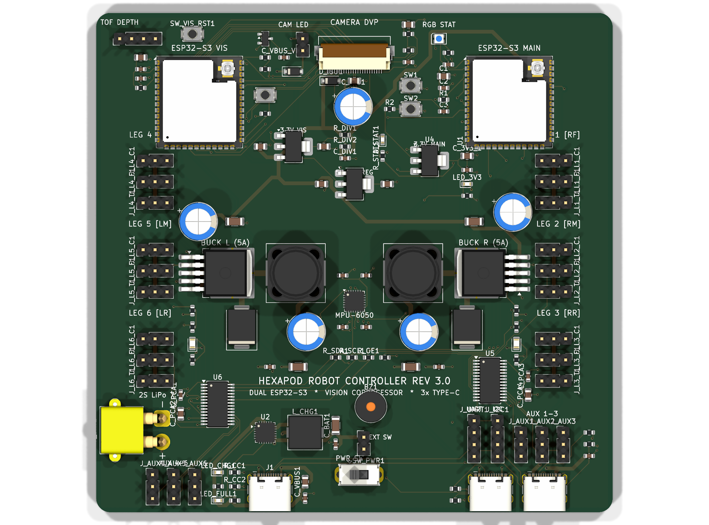

## 🦀 System Overview

**Tarsus** is an advanced 18-DOF autonomous hexapod robot engineered completely from the ground up: custom 4-layer electronics, deterministic Zephyr RTOS locomotion firmware, ESP-IDF computer vision pipeline, ROS 2 kinematics packages, and a cross-platform Kivy telemetry interface.



---

## 🗺️ System Architecture

```
+--------------------------------------------------------------------------+
|                          tarsus_main_board (Rev 3.0)                     |
|                                                                          |
|  +---------------------------+           +----------------------------+  |
|  | Main MCU (ESP32-S3, U1)   |           | Vision Coprocessor (U8)    |  |
|  | - Zephyr RTOS Firmware    | <=======> | - ESP-IDF Framework        |  |
|  | - 18-DOF Inverse Kinematics|   UART    | - 8MB PSRAM (N8R8)         |  |
|  | - Zenoh-Pico Telemetry    |           | - OV3660 DVP Camera (24-pin)| |
|  +-------------+-------------+           | - MaixSense A010 3D ToF    |  |
|                |                         +-------------+--------------+  |
|      I2C Bus   v                                       | WiFi Stream     |
|  +-------------+-------------+                         v                 |
|  | 2x PCA9685 (0x40 & 0x41)  |                 +---------------+         |
|  | - 18x Servo PWM Signals   |                 | tarsus_lair   |         |
|  | MPU-6050 IMU (At CoM)     |                 | (Kivy App)    |         |
|  +---------------------------+                 +---------------+         |
+--------------------------------------------------------------------------+
```

---

## 🔌 Hardware & Power Distribution (KiCad 10)

The heart of Tarsus is a custom **4-layer PCB** (100 × 80 mm) designed in **KiCad 10** with 100% clean ERC/DRC verification:



1. **Dual ESP32-S3 Architecture**:
   - **`U1` (Locomotion Engine):** Dedicated ESP32-S3-WROOM-1U with external IPEX U.FL antenna, computing inverse kinematics, gait generation (tripod, wave, ripple), and servo interpolation at 100 Hz.
   - **`U8` (Perception Engine):** ESP32-S3-WROOM-1U-N8R8 with 8 MB Octal PSRAM handling DVP camera frame capture (OV3660 / OV2640) and Sipeed MaixSense A010 3D Time-of-Flight depth point-clouds.

2. **Power Architecture**:
   - **Battery & Charging:** Dual-cell 2S LiPo pack charged by a **Texas Instruments BQ25886** I2C switch-mode boost charger with USB BC1.2 source detection and dynamic PowerPath management.
   - **Dual 5A High-Current Buck Converters:** Two independent **XL4015** 5A switching regulators (`V_SERVO_L` and `V_SERVO_R`) cleanly isolate left-side (legs 4–6) and right-side (legs 1–3) servo transients to prevent MCU brownouts.
   - **Triple USB-C Architecture:** Independent USB-C ports for main locomotion programming, vision coprocessor flashing/debugging, and high-speed battery charging.

3. **Inertial & Sensory Layer**:
   - **MPU-6050 6-Axis IMU** routed directly at the board's geometric Center of Mass (CoM) for accurate pitch/roll posture stabilization.
   - Dual **PCA9685** 16-channel 12-bit PWM controllers with external output-enable safety cutoffs.

---

## 💻 Software & Monorepo Structure

The project is maintained as a cohesive monorepo:

```
Tarsus/
├── electronics/
│   └── tarsus_main_board/        ← KiCad 10 PCB project (Rev 3.0)
├── software/
│   ├── tarsus_firmware/          ← Zephyr RTOS (Locomotion MCU)
│   ├── tarsus_vision_firmware/   ← ESP-IDF (Vision Coprocessor)
│   ├── tarsus_ros/               ← ROS 2 Jazzy workspace & bringup
│   └── tarsus_lair/              ← Cross-platform Kivy app
└── mechanics/
    └── freecad/                  ← Parametric body and coxa/femur/tibia CAD
```

- **GitHub Repository:** [github.com/EnejiOhieku/Tarsus](https://github.com/EnejiOhieku/Tarsus)
