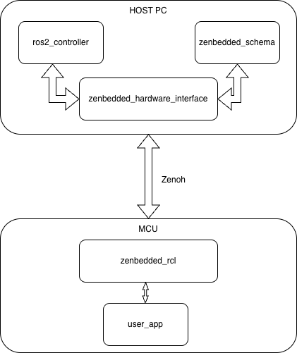

## 🚀 Overview

**Zenbedded** is an official open-source initiative under the **`ros-controls`** organization designed to bring microcontrollers running **Zephyr RTOS** into **`ros2_control`** as first-class, low-latency, agent-less participants.

Traditional microcontroller integrations in ROS 2 often depend on heavy middleware layers or serial broker agents (like micro-ROS agents) that introduce serialization jitter, memory overhead, and single points of failure. Zenbedded leverages the ultra-lean **Zenoh** wire protocol and direct real-time shared buffers to achieve deterministic sub-millisecond loop closures between host computers and embedded targets.

---

## 🗺️ System Architecture



```
+-------------------------------------------------------------+
|               Host Computer (Linux / ROS 2)                 |
|  controller_manager (100–1000 Hz) <---> InvertedPendulumCtrl |
|                          |                                  |
|         zenbedded_hardware_interface (SystemInterface)      |
|             realtime_tools::RealtimeBuffer                  |
+------------------------------+------------------------------+
                               | Zenoh C++ API (TCP/UDP/Serial)
                               v
+-------------------------------------------------------------+
|                      Zenoh Transport Mesh                   |
|         rt/robot/state <===============> rt/robot/cmd       |
+------------------------------+------------------------------+
                               | Zenoh-Pico C (Client Mode)
                               v
+-------------------------------------------------------------+
|           Microcontroller (ESP32-S3 / Zephyr RTOS)          |
|  - zenbedded_rcl: Multi-Pub/Sub Client + ABA Double-Buffer  |
|  - zenbedded_transport: MicroCDR / Packed Struct Codecs     |
|  - Fast Sensor Thread (400 Hz Sampling - AS5600 Encoder)    |
|  - Control Thread (100 Hz Step/Dir - TMC2209 Stepper)       |
+-------------------------------------------------------------+
```

---

## ⚡ Tier 1 vs. Tier 2 Wire Architecture

Zenbedded introduces a dual-tier serialization model to support both general-purpose ROS 2 interoperability and maximum control frequency:

| Feature | **Tier 1 (CDR Native)** | **Tier 2 (No-CDR Raw Struct)** |
| :--- | :--- | :--- |
| **Serialization** | Standard MicroCDR (`sensor_msgs/msg/JointState`) | Zero-copy flat `#pragma pack(push, 1)` binary |
| **ROS 2 Interoperability** | Native with any ROS 2 node via `rmw_zenoh_cpp` | Optimized for `zenbedded_hardware_interface` |
| **Wire Overhead** | ~40–60 bytes CDR headers + alignment padding | **0 bytes padding**; exactly $N \times \text{sizeof(type)}$ |
| **4 Doubles Payload** | ~96+ bytes on wire | **32 bytes** on wire |
| **Target Use Case** | Broad ecosystem tooling & standard topics | Ultra high-frequency closed-loop control (500–1000 Hz) |

---

## 🛠️ Key Contributions & Architecture

As a core member and contributor to Zenbedded, my work includes:

1. **`zenbedded_hardware_interface`**:
   - Engineered the `SystemInterface` plugin for `ros2_control` with lock-free `realtime_tools::RealtimeBuffer` and `RealtimeThreadSafeBox` protection.
   - Designed schema-driven dynamic interface export (`InterfaceSchema`) loaded from declarative YAML configs.

2. **`zenbedded_transport`**:
   - Integrated **Zenoh-Pico v1.6.2** into Zephyr RTOS with dual UDP and TCP backends.
   - Authored the MicroCDR serialization engine and schema-driven code generation (`generate_tier2_payload.py`).
   - Implemented USB CDC ECM Ethernet emulation transport alongside Wi-Fi for ultra-low latency physical tethering.

3. **`zenbedded_rcl`**:
   - Designed the embedded client library providing `ZenbeddedClient<StateCodec, CommandCodec>`.
   - Engineered lock-free double-buffering with ABA versioning to guarantee that high-speed sensor threads (400 Hz) never block real-time transport tasks.

4. **Rotary Inverted Pendulum (Furuta Pendulum Demo)**:
   - Built a complete physical validation bench with an **ESP32-S3**, **AS5600 magnetic encoder** over I2C at 400kHz, and **TMC2209** stepper driver.
   - Formulated both classical energy-shaping swing-up + LQR balancing, and an embedded C++ DDPG reinforcement learning controller with `tiny_nn` Adam optimizer.
   - Built an interactive in-process 3D visualizer using **Raylib**.

---

## 🔗 Key Pull Requests & Links

- **Repository:** [github.com/ros-controls/zenbedded](https://github.com/ros-controls/zenbedded)
- **PR #107:** Multi-channel end-to-end integration
- **PR #106:** Multi-publisher and multi-subscriber API similar to RCLCPP
- **PR #105:** Lock-free double buffer standalone architecture
- **PR #104:** Transport pub/sub undeclaration API and session reference counting
- **PR #103:** Upgrade to RealtimeThreadSafeBox and lifecycle methods
- **PR #97:** End-to-end user guide for Inverted Pendulum bench
- **PR #92:** USB CDC ECM transport selection alongside Wi-Fi
- **PR #91:** Raylib 3D visualizer build & GUI display pass-through
